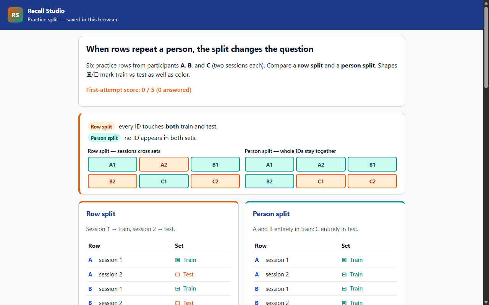
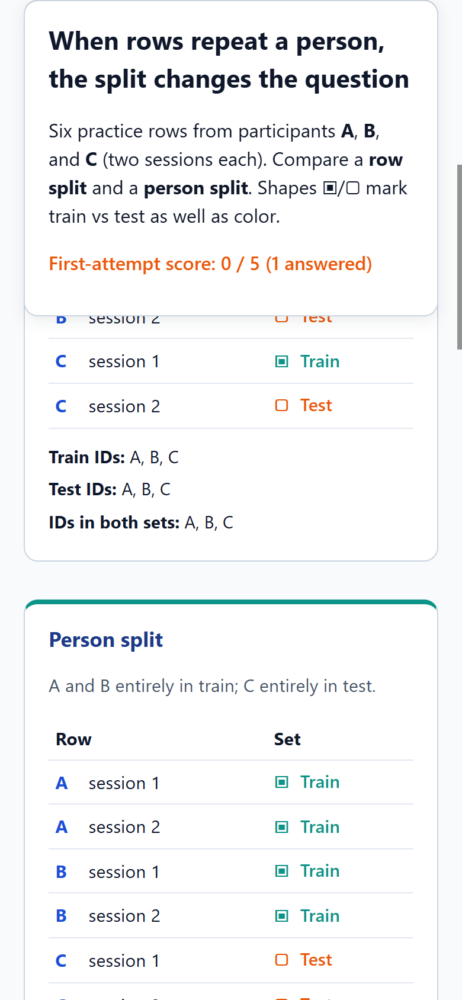

# Recall Studio (independent exercise)

Original browser lesson about **train/test splits when rows repeat the same fictional participant**. This is a new portfolio exercise—not a recovered historical product.





## Problem

Repeated rows from the same person can leak into both train and test. The lesson shows six practice rows (A/B/C × two sessions) under a **row split** and a **person split**, then asks five fixed multiple-choice questions. First attempts score once; retries and self-rated reflection stay separate.

## One-minute walkthrough

1. Open the site root and read the contrast banner, mini grids, and both split tables.
2. Answer the five questions — your first choice locks for scoring.
3. If you miss, read the journal (including what you picked) and use the retry block.
4. Reveal the reflection explanation when ready, then self-rate.
5. Reload to confirm progress persists; **Reset this lesson** clears only this app’s storage key.

## Tests

```bash
npm test
npm run verify:demo
npm run capture:evidence
```

`npm run verify:demo` serves the repo the way GitHub Pages will (`/recall-studio/` project site), on a dynamic loopback port, and checks locked first answers, retry visibility, practice reset, and the storage-unavailable banner.

## Engineering decision

**First-attempt answers are immutable** in saved state; the UI disables those radios so the visible choice always matches the recorded score after reload.

## Limitation

No model is trained—only split membership and quiz logic.

## Local preview

Stage the site root the same way verification does: serve a folder that contains a `recall-studio/` directory with `index.html`, `app.js`, `logic.js`, and `styles.css`. The discoverable entry URL ends with `/recall-studio/`.
